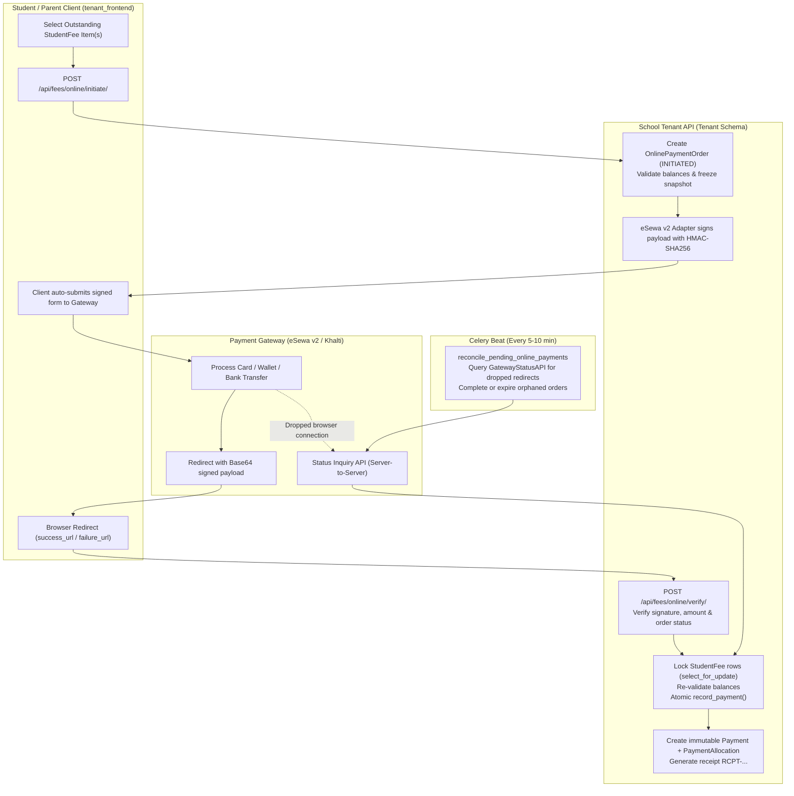
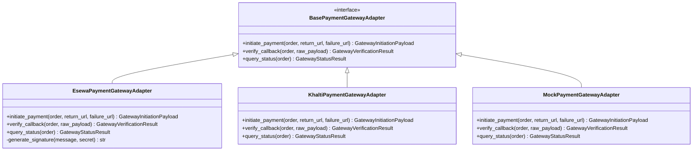
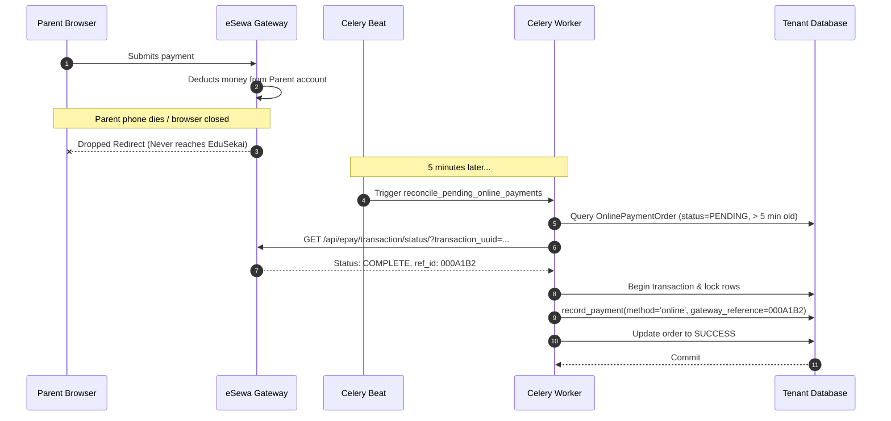
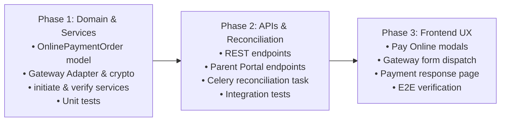

# EduSekai — P1 Student Online Fee Payments: Architecture Audit & Implementation Plan

> **Release Milestone:** P1 Online Fee Payments  
> **Repository:** `D:\MAIN-GIT-CLONE-REPOS\ERP`  
> **Status:** Architecture Audit & Planning Phase (Implementation On Hold Pending Review)  
> **Date:** October 2026  

---

## Executive Summary

This document provides a comprehensive architecture audit and technical implementation plan for **Student Online Fee Payments** within EduSekai's multi-tenant School MIS SaaS.

Currently, EduSekai supports:
1. **Manual fee collection** in individual tenant schemas (`fees` app: cash, cheque, bank transfer, UPI recorded by authorized staff via `RecordPaymentView`).
2. **SaaS platform onboarding payments** in the `public` schema (`payments` app: initial school subscription payment via eSewa v2 to activate a school tenant).

**Crucially, there is currently NO online fee payment mechanism for students or parents in school tenant schemas.**
This audit establishes an enterprise-grade, secure, and idempotent online payment architecture that allows parents and students to pay school fees online using **eSewa v2** (and extensible to **Khalti**), while strictly preserving tenant isolation, immutable financial audit trails, and concurrency protections.



---

## 1. Current Payment Architecture & Codebase Inspection

### 1.1 Tenant Fee Domain (`backend/fees/`)
The tenant fee management module resides in individual school tenant schemas (`TENANT_APPS`):
- **`FeeHead`**: Configurable fee categories (e.g. Tuition, Transport, Lab, Annual Day).
- **`FeeStructure`**: Definition layer specifying standard amounts per `FeeHead`, `AcademicYear`, `AcademicLevel`, and `Section`.
- **`StudentFee`**: Source of truth for per-student debt obligations.
  - Snapshots `level_name` and `section_name` at assignment time.
  - Stores `amount_due`, `discount_amount`, `due_date`, and `status` (`active` or `cancelled`).
  - Immutable once any allocation exists (`can_edit_student_fee`).
- **`Payment`**: Immutable financial ledger entry representing actual collected funds.
  - Fields: `id`, `student`, `amount`, `method` (`cash`, `bank_transfer`, `upi`, `cheque`, `online`), `status` (`completed`, `reversed`), `receipt_number` (`RCPT-...`), `reference_note`, `gateway_reference`, `reverses`, `recorded_by`.
  - **Critical Rule**: `Payment` rows are never mutated, edited, or deleted (`on_delete=PROTECT`). Reversals create an offsetting `Payment` with `status="reversed"`.
  - A receipt is not a separate database entity; it is a computed view of the `Payment` and its allocations.
- **`PaymentAllocation`**: Maps a `Payment` to one or more `StudentFee` rows.
  - Check constraint: `~Q(amount=0)` enforces non-zero allocation amounts.
  - Sum of positive and negative allocations against a `StudentFee` gives net amount paid.

### 1.2 Financial Calculation & Concurrency Engine (`fees/services.py`)
- Outstanding balance calculation:
  $$\text{Outstanding} = \text{amount\_due} - \text{discount\_amount} - \sum \text{allocations}$$
- **`record_payment()`**:
  - Decorated with `@transaction.atomic`.
  - Locks all referenced `StudentFee` rows using `select_for_update().order_by("id")`.
  - Validates:
    1. $\sum \text{allocations} == \text{amount}$
    2. All fees belong to the specified student.
    3. All fees are in `active` status.
    4. No allocation exceeds the current outstanding balance of the locked `StudentFee`.
  - Issues atomic bulk creation of `PaymentAllocation` records and sets `receipt_number`.

### 1.3 SaaS Registration Payments (`backend/payments/`) vs School Tenant Fees
A strict architectural boundary separates SaaS subscription payments from student fee payments:

| Dimension | SaaS Registration (`payments`) | Student Fee Payments (`fees`) |
| :--- | :--- | :--- |
| **Database Schema** | `public` schema (`SHARED_APPS`) | `tenant_<subdomain>` schema (`TENANT_APPS`) |
| **Payer** | Prospective School Administrator / Owner | Enrolled Student or Linked Parent |
| **Recipient** | EduSekai SaaS Platform Owner | The Specific School / Institution |
| **Payee Bank/Merchant** | EduSekai Platform eSewa Account | School's Own Bank Account or School Escrow |
| **Target Obligation** | Subscription / Tenant License | `StudentFee` (Tuition, Transport, Exams, etc.) |
| **Existing Model** | `payments.Payment` (stores temporary signup credentials, `organization_name`, `subdomain`) | `fees.Payment` & `fees.PaymentAllocation` |
| **Reversibility** | Tenant provisioning lifecycle | Audited reversal with negative `PaymentAllocation` |

> [!CAUTION]
> The `backend/payments/models.py:Payment` model MUST NOT be used for student fees. It is strictly scoped to the public schema for tenant onboarding. Student online fees must live entirely within `backend/fees/` in each tenant's schema.

---

## 2. Reusable Components & Gaps Analysis

### 2.1 Reusable Components
1. **eSewa Signature Generation (`backend/payments/utils.py`)**:
   - `generate_esewa_signature(secret_key, message)` implements HMAC-SHA256 Base64 encoding.
   - Message signing format: `"total_amount=X,transaction_uuid=Y,product_code=Z"`.
   - Tested and verified under Phase 0 security remediations.
2. **Timing-Safe Signature Verification (`backend/payments/views.py`)**:
   - Dynamic message assembly from `signed_field_names`:
     ```python
     fields = [f.strip() for f in signed_field_names.split(",") if f.strip()]
     message = ",".join(f"{field}={decoded_json.get(field, '')}" for field in fields)
     expected_signature = generate_esewa_signature(secret, message)
     hmac.compare_digest(expected_signature, provided_signature)
     ```
3. **Receipt Aggregation & Serialization (`backend/fees/serializers.py`, `views.py`)**:
   - `PaymentReceiptView` and `PaymentSerializer` provide complete receipt serialization.
4. **Child-Parent Scoping Engine (`backend/families/models.py`, `backend/fees/services.py`)**:
   - `get_child_for_parent(parent, student_id)` guarantees parents only access their linked children.

### 2.2 Architectural & Implementation Gaps
1. **No Order / Intent Tracking Model**:
   - `fees.Payment` represents completed money received. It requires positive allocations immediately upon creation.
   - If an online payment is initiated, we cannot create a `fees.Payment` row because:
     - The user might abandon the payment on eSewa.
     - The payment might be rejected by the bank.
     - Creating a `Payment` prematurely would falsely reduce the student's outstanding balance.
   - **Gap**: Need an `OnlinePaymentOrder` model to track state transitions (`INITIATED` $\to$ `PENDING` $\to$ `SUCCESS` / `FAILED` / `EXPIRED`).
2. **Missing Parent & Student Payment Initiation Endpoints**:
   - Current `RecordPaymentView` requires staff permission `collect_payments`.
   - Neither students nor parents can initiate payment transactions.
3. **Gateway Callback & Webhook Handler Missing in Tenant Schema**:
   - No callback endpoint exists in `backend/fees/urls.py` to receive eSewa redirects and verify cryptographic payloads.
4. **Dropped Redirect Vulnerability**:
   - If a parent pays on eSewa but closes their phone browser before redirecting to `success_url`, the money is deducted from their wallet, but EduSekai would never record the payment.
   - **Gap**: Need server-to-server transaction status inquiry and a background Celery reconciliation task.
5. **Tenant Gateway Credentials**:
   - Currently, `settings.ESEWA_CLIENT_SECRET` and `settings.ESEWA_PRODUCT_CODE` are global environment variables.
   - Schools require their own merchant credentials (or a fallback to platform escrow).

---

## 3. Recommended Payment Gateway Integration

### 3.1 Primary Gateway: eSewa v2 EPAY Protocol
eSewa is Nepal's dominant digital wallet and payment gateway. EduSekai already implements eSewa v2 for SaaS signup.

#### A. Initiation (Form POST Redirect)
- Gateway Endpoint:
  - UAT/Sandbox: `https://rc-epay.esewa.com.np/api/epay/main/v2/form`
  - Production: `https://epay.esewa.com.np/api/epay/main/v2/form`
- Form Parameters:
  - `amount`: Base amount to pay (e.g. `"5000.00"`).
  - `tax_amount`: `"0"`
  - `total_amount`: Total amount including tax/charges (e.g. `"5000.00"`).
  - `transaction_uuid`: Unique order UUID (e.g. `order.id.hex`).
  - `product_code`: Merchant product code (e.g. `"EPAYTEST"` or tenant-configured code).
  - `product_service_charge`: `"0"`
  - `product_delivery_charge`: `"0"`
  - `success_url`: Tenant callback URL (`https://<tenant-subdomain>.domain/api/fees/online/callback/success/` or frontend landing page).
  - `failure_url`: Tenant callback URL (`https://<tenant-subdomain>.domain/api/fees/online/callback/failure/`).
  - `signed_field_names`: `"total_amount,transaction_uuid,product_code"`
  - `signature`: Base64 HMAC-SHA256 signature generated with tenant's secret.

#### B. Callback Response Verification
Upon payment completion, eSewa redirects to `success_url?data=<Base64JSON>`:
- Decoded JSON attributes:
  ```json
  {
    "transaction_code": "000A1B2",
    "status": "COMPLETE",
    "total_amount": "5000.00",
    "transaction_uuid": "e81d7f45b7a048a1b6928e469502b451",
    "product_code": "EPAYTEST",
    "signed_field_names": "transaction_code,status,total_amount,transaction_uuid,product_code,signed_field_names",
    "signature": "M44iU0b..."
  }
  ```
- Verification steps:
  1. Decode Base64 string safely.
  2. Verify `status == "COMPLETE"`.
  3. Validate `total_amount == order.amount`.
  4. Construct signature payload from `signed_field_names` strictly in the order returned.
  5. Calculate HMAC-SHA256 using the merchant secret and compare using `hmac.compare_digest`.

#### C. Server-to-Server Transaction Status API (Reconciliation)
- Endpoint: `GET https://rc.esewa.com.np/api/epay/transaction/status/`
- Query Parameters: `?product_code=EPAYTEST&total_amount=5000.00&transaction_uuid=<order_id>`
- Response:
  ```json
  {
    "product_code": "EPAYTEST",
    "transaction_uuid": "e81d7f45...",
    "total_amount": 5000.0,
    "status": "COMPLETE",
    "ref_id": "000A1B2"
  }
  ```
- Enables automated verification of payments even if the user drops off before the browser redirect completes.

### 3.2 Gateway Adapter Architecture (Extensible to Khalti / Fonepay)
To prevent vendor lock-in, payment processing is decoupled behind an abstract adapter interface:



---

## 4. Proposed Data Models & Database Schema

### 4.1 New Model: `fees.OnlinePaymentOrder`
Resides in the **tenant schema** (`backend/fees/models.py`). Tracks the lifecycle of an online payment intent before finalization into `fees.Payment`.

```python
class OnlinePaymentOrder(models.Model):
    class Status(models.TextChoices):
        INITIATED = "initiated", "Initiated"
        PENDING = "pending", "Pending Gateway Confirmation"
        SUCCESS = "success", "Payment Completed"
        FAILED = "failed", "Payment Failed"
        EXPIRED = "expired", "Order Expired"

    class Gateway(models.TextChoices):
        ESEWA = "esewa", "eSewa"
        KHALTI = "khalti", "Khalti"

    id = models.UUIDField(primary_key=True, default=uuid.uuid4, editable=False)
    student = models.ForeignKey("students.Student", on_delete=models.PROTECT, related_name="online_payment_orders")
    
    amount = models.DecimalField(max_digits=10, decimal_places=2)
    gateway = models.CharField(max_length=20, choices=Gateway.choices, default=Gateway.ESEWA)
    status = models.CharField(max_length=20, choices=Status.choices, default=Status.INITIATED, db_index=True)
    
    # Intended fee allocations: JSON list of {"student_fee_id": "<uuid>", "amount": "1500.00"}
    allocations_snapshot = models.JSONField(help_text="Intended allocation per StudentFee snapshot at order creation")
    
    # Gateway tracking
    gateway_order_id = models.CharField(max_length=255, unique=True, db_index=True)  # transaction_uuid sent to gateway
    gateway_reference = models.CharField(max_length=255, blank=True)                 # transaction_code / ref_id returned by gateway
    gateway_response = models.JSONField(default=dict, blank=True)                    # raw verified callback response
    
    # Audit trail
    created_by = models.ForeignKey("accounts.User", on_delete=models.PROTECT, related_name="+")
    created_at = models.DateTimeField(auto_now_add=True, db_index=True)
    expires_at = models.DateTimeField(db_index=True)
    completed_at = models.DateTimeField(null=True, blank=True)
    
    # Linked permanent payment (created atomically upon SUCCESS)
    payment = models.OneToOneField(
        "fees.Payment",
        on_delete=models.PROTECT,
        null=True,
        blank=True,
        related_name="online_order",
        help_text="Immutable Payment created once this order succeeded"
    )

    class Meta:
        ordering = ["-created_at"]
        indexes = [
            models.Index(fields=["student", "status"]),
            models.Index(fields=["status", "expires_at"]),
        ]
```

### 4.2 Tenant Gateway Configuration (`fees.TenantPaymentGatewayConfig`)
Allows individual schools to configure their own merchant credentials, falling back to global settings when unconfigured:

```python
class TenantPaymentGatewayConfig(models.Model):
    gateway = models.CharField(max_length=20, choices=OnlinePaymentOrder.Gateway.choices, unique=True)
    is_active = models.BooleanField(default=True)
    merchant_code = models.CharField(max_length=100)
    # Stored encrypted using accounts.utils.crypto.encrypt_secret
    encrypted_secret = models.CharField(max_length=512)
    updated_at = models.DateTimeField(auto_now=True)
```

---

## 5. Security, Concurrency & Idempotency Controls

### 5.1 Concurrency & Overpayment Prevention
A major risk in school fees is concurrent settlement:
*Scenario*: A parent initiates an online payment of Rs 5,000 for Tuition. While they are entering their credentials on eSewa, the student pays Rs 5,000 cash at the school cashier counter.
*Protection Workflow*:
1. At **Order Initiation**:
   - Check that requested allocations do not exceed each `StudentFee`'s current outstanding balance.
   - Reject new initiation if an active, unexpired `INITIATED` or `PENDING` order already exists for the same fee.
2. At **Callback Verification** (Critical Gate):
   - Wrap in `@transaction.atomic`.
   - Lock `OnlinePaymentOrder` via `select_for_update()`.
   - If order is already `SUCCESS`, return existing payment data immediately (idempotency).
   - Lock target `StudentFee` rows in stable ID order (`select_for_update().order_by("id")`).
   - Re-evaluate outstanding balances:
     - **Normal Path**: Outstanding balance is still sufficient $\implies$ Call `record_payment()` with `method="online"`, link `payment`, transition order to `SUCCESS`.
     - **Interim Payment Conflict**: If outstanding balance was reduced in the interim and is now lower than the payment amount:
       - DO NOT crash or discard the transaction!
       - The parent's bank was already charged.
       - Allocate up to the remaining outstanding balance, and credit the remainder to an "Advance/Credit" fee head, OR flag the order as `NEEDS_RECONCILIATION` and raise an automated bursar notification.

### 5.2 Cryptographic Verification & Webhook Idempotency
- **Timing Attack Resistance**: All signature comparisons use `hmac.compare_digest`.
- **Payload Tampering**: Signature message format strictly matches eSewa's required alphabetical/ordered specification.
- **Idempotent Webhooks**: If eSewa calls the verification endpoint repeatedly (or user refreshes), the order state check `order.status == Status.SUCCESS` returns HTTP 200 with the already-issued receipt without executing duplicate allocations.

### 5.3 Automated Reconciliation for Dropped Redirects
A Celery Beat periodic task handles abandoned browser sessions:



---

## 6. Proposed API Design & Contracts

### 6.1 Endpoints Specification

| Method | Endpoint | Audience | Description | Permissions Required |
| :--- | :--- | :--- | :--- | :--- |
| `POST` | `/api/fees/online/initiate/` | Student / Staff | Creates an `OnlinePaymentOrder` and returns signed gateway payload | `view_own_fees` (self) OR `collect_payments` (staff) |
| `POST` | `/api/parent-portal/children/<id>/pay-fees/` | Parent | Creates an `OnlinePaymentOrder` for a linked child | `view_child_fees` + `StudentParentRelation` |
| `POST` | `/api/fees/online/verify/` | Student / Parent / Staff | Client sends returned callback query parameters to verify and finalize payment | `IsAuthenticated` |
| `GET` | `/api/fees/online/callback/` | Gateway Redirect | Browser redirect landing endpoint for eSewa callback | Public / Authenticated Session |
| `GET` | `/api/fees/online/orders/<id>/` | Order Creator | Poll order status during pending state | Order ownership or `view_fees` |

### 6.2 Initiation Request & Response

#### Request (`POST /api/fees/online/initiate/`)
```json
{
  "student": "550e8400-e29b-41d4-a716-446655440000",
  "gateway": "esewa",
  "allocations": [
    {
      "student_fee": "7a3f81e2-5b91-4e78-9a4d-112233445566",
      "amount": "3500.00"
    },
    {
      "student_fee": "9b1c72d3-6c82-4f89-8b5e-223344556677",
      "amount": "1500.00"
    }
  ]
}
```

#### Response (`HTTP 201 Created`)
```json
{
  "order_id": "c9a4b8d1-1234-5678-9abc-def012345678",
  "gateway": "esewa",
  "gateway_url": "https://rc-epay.esewa.com.np/api/epay/main/v2/form",
  "form_parameters": {
    "amount": "5000.00",
    "tax_amount": "0",
    "total_amount": "5000.00",
    "transaction_uuid": "c9a4b8d1123456789abcdef012345678",
    "product_code": "EPAYTEST",
    "product_service_charge": "0",
    "product_delivery_charge": "0",
    "success_url": "https://school1.localhost:3000/dashboard/fees/payment-response?status=success",
    "failure_url": "https://school1.localhost:3000/dashboard/fees/payment-response?status=failure",
    "signed_field_names": "total_amount,transaction_uuid,product_code",
    "signature": "M44iU0bK6XvR..."
  }
}
```

### 6.3 Verification Request & Response

#### Request (`POST /api/fees/online/verify/`)
```json
{
  "encoded_data": "eyJ0cmFuc2FjdGlvbl9jb2RlIjoiMDAwQTFCMiIsInN0YXR1cyI6IkNPTVBMRVRFIiwidG90YWxfYW1vdW50IjoiNTAwMC4wMCIsInRyYW5zYWN0aW9uX3V1aWQiOiJjOWE0YjhkMSIsInByb2R1Y3RfY29kZSI6IkVQQVlURVNUIiwic2lnbmVkX2ZpZWxkX25hbWVzIjoidHJhbnNhY3Rpb25fY29kZSxzdGF0dXMsdG90YWxfYW1vdW50LHRyYW5zYWN0aW9uX3V1aWQscHJvZHVjdF9jb2RlLCIsInNpZ25hdHVyZSI6IkFCQzEyMy4uLiJ9"
}
```

#### Response (`HTTP 200 OK`)
```json
{
  "status": "success",
  "message": "Payment verified and recorded successfully.",
  "receipt": {
    "id": "f83b1234-5678-9abc-def0-123456789abc",
    "receipt_number": "RCPT-8B7C9D0E1F",
    "amount": "5000.00",
    "method": "online",
    "status": "completed",
    "gateway_reference": "000A1B2",
    "created_at": "2026-10-16T14:30:00Z",
    "allocations": [
      {
        "student_fee_id": "7a3f81e2-5b91-4e78-9a4d-112233445566",
        "fee_head_name": "Tuition Fee",
        "amount": "3500.00"
      },
      {
        "student_fee_id": "9b1c72d3-6c82-4f89-8b5e-223344556677",
        "fee_head_name": "Bus Transport",
        "amount": "1500.00"
      }
    ]
  }
}
```

---

## 7. Frontend User Experience Design

### 7.1 Student "My Fees" (`tenant_frontend/src/app/dashboard/fees/my-fees/page.tsx`)
1. **Interactive Pay Button**:
   - Outstanding Balance card gains an active **"Pay Online"** primary button when `total_outstanding > 0`.
2. **Payment Selection Modal**:
   - Allows quick selection: "Pay Full Balance" or individual checkboxes for specific fee heads.
   - Shows allocated breakdown and total payable amount.
3. **Gateway Dispatch**:
   - Clicking "Proceed to Payment" invokes `useInitiateOnlineFeePayment()`.
   - On response, dynamically injects and submits a hidden HTML `<form>` directly to eSewa's endpoint.

### 7.2 Parent Portal "Child Fees" (`tenant_frontend/src/app/dashboard/parent-portal/fees/page.tsx`)
1. **Child Context Preservation**:
   - Seamlessly integrates with the existing `ChildSwitcher` component.
   - Restricts fee selection strictly to the active selected child.
2. **Action Bar**:
   - Clear banner: *"Total Outstanding for [Child Name]: Rs X,XXX"*.
   - Primary action: *"Pay Fees Online"*.

### 7.3 Response Handler (`/dashboard/fees/payment-response/page.tsx`)
- Reads URL query parameters (`data` on success or error codes on failure).
- Displays animated verification loader while calling `/api/fees/online/verify/`.
- On success:
  - Renders a green success card with animated checkmark.
  - Displays the generated `receipt_number`.
  - Provides a **"Print / Download Receipt"** button (reusing the print-friendly receipt layout).
  - Offers a button to return to fee dashboard.
- On failure/cancellation:
  - Explains the failure reason clearly (e.g. transaction cancelled by user, bank timeout).
  - Provides a **"Retry Payment"** button that navigates back without losing selection context.

---

## 8. Comprehensive Test Plan

| Test Class | Focus Area | Scenarios Covered |
| :--- | :--- | :--- |
| **`OnlinePaymentOrderModelTests`** | Domain Models | Order creation, default `INITIATED` status, allocation JSON validation, expiration timestamps, string representation. |
| **`EsewaAdapterTests`** | Gateway Cryptography | Signature generation matching eSewa specification, payload encoding, tamper detection with altered amount or order ID. |
| **`OnlineFeeInitiateApiTests`** | Initiation API | Student initiating payment for self (201), Parent initiating for linked child (201), Parent initiating for unlinked child (403), Non-student/parent user without permissions (403), Overpayment request exceeding outstanding balance (400), Negative or zero allocation amount (400). |
| **`OnlineFeeVerifyApiTests`** | Verification API | Valid Base64 callback processing (200), Idempotent retry of completed callback (200, no duplicate payment), Forged HMAC signature (400), Corrupted Base64 payload (400), Amount mismatch between gateway and order (400). |
| **`OnlinePaymentConcurrencyTests`** | Race Safety | Concurrent verification of same order (only 1 succeeds, no duplicate allocations), Concurrent cash collection while online payment is pending (proper rejection or credit allocation without crashing). |
| **`ReconciliationTaskTests`** | Background Worker | Celery task polls pending orders > 5 min, updates confirmed orders to `SUCCESS`, marks expired orders (> 24h) to `EXPIRED`. |

---

## 9. Phased Implementation Roadmap & Risk Management



### Risk Assessment & Mitigation

| Risk | Impact | Likelihood | Mitigation Strategy |
| :--- | :--- | :--- | :--- |
| **Double Allocation / Duplicate Receipts** | High | Medium | Enforce database-level uniqueness on `gateway_order_id` and OneToOne relation between `OnlinePaymentOrder` and `Payment`. Wrap verification in `select_for_update` row locks. |
| **User Abandonment / Browser Dropoff** | Medium | High | Implement Celery Beat reconciliation task that checks eSewa transaction status API every 5 minutes. |
| **Cross-Tenant Gateway Leakage** | Critical | Low | All `OnlinePaymentOrder` models live inside individual tenant schemas. Domain routing ensures callbacks resolve in the correct schema context. |
| **Gateway Secret Key Exposure** | Critical | Low | Secrets stored encrypted at rest or in environment variables; never sent to frontend. Frontend only receives signed hashes and public product codes. |

---

## 10. Verification Gate & Approval Request

This architecture plan is fully aligned with EduSekai's domain patterns, security standards, and schema boundaries.
**No database migrations, schema alterations, or code modifications have been made yet.**

Please review this architecture plan and confirm authorization to proceed with **Phase 1: Backend Domain Models & Service Implementation**.

