# EDU Sekai — System Architecture and Module Workflows

> **Scope:** Documentation only. Diagrams distinguish current code from proposed, unimplemented workflows. Based on repository inspection; this is not a runtime verification.

## 1. System architecture

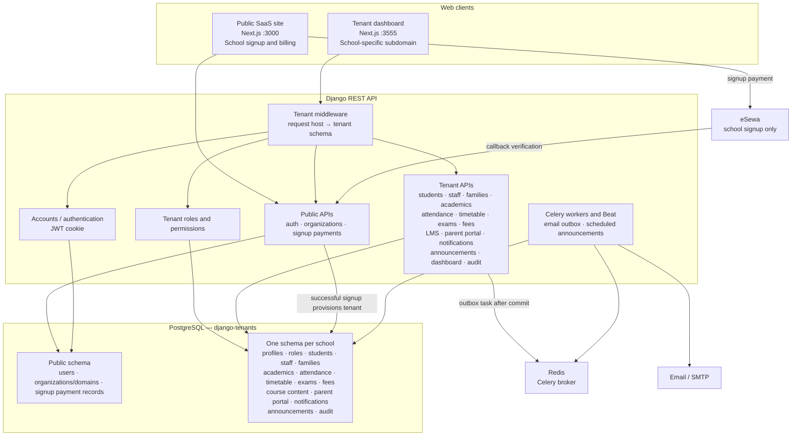

**Tenant isolation:** The school subdomain/domain selects the PostgreSQL schema. Operational school records are tenant-local. Global accounts are in the public schema and are referenced from tenant profiles with UUID soft links, not cross-schema foreign keys.

## 2. Current core school workflow

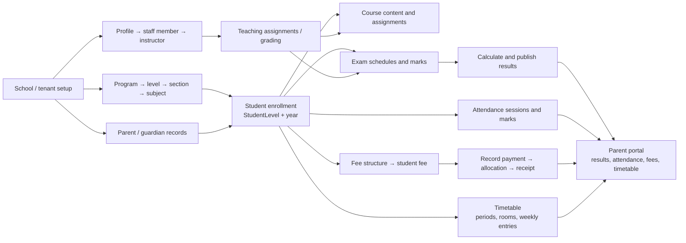

## 3. Current module workflows

### 3.1 Tenant provisioning, login and access control

```mermaid
sequenceDiagram
    actor Owner as School owner
    participant Site as Public Next.js site
    participant API as Django API
    participant Gateway as eSewa
    participant PublicDB as Public schema
    participant TenantDB as Tenant schema
    Owner->>Site: Submit school and owner details
    Site->>API: Initialize signup payment
    API->>PublicDB: Store pending signup payment
    API-->>Site: Payment details and signature
    Site->>Gateway: Complete payment
    Gateway->>API: Callback
    API->>API: Verify signature and amount
    API->>PublicDB: Mark payment complete; create organization/domain/user
    API->>TenantDB: Create tenant schema and migrate
    Owner->>API: Log in on school domain
    API->>TenantDB: Resolve local profile and tenant role
    API->>PublicDB: Authenticate global account
    API-->>Owner: JWT cookies
```

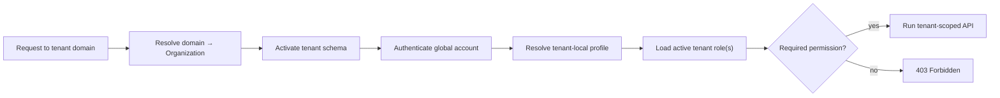

### 3.2 Student, academic and family lifecycle

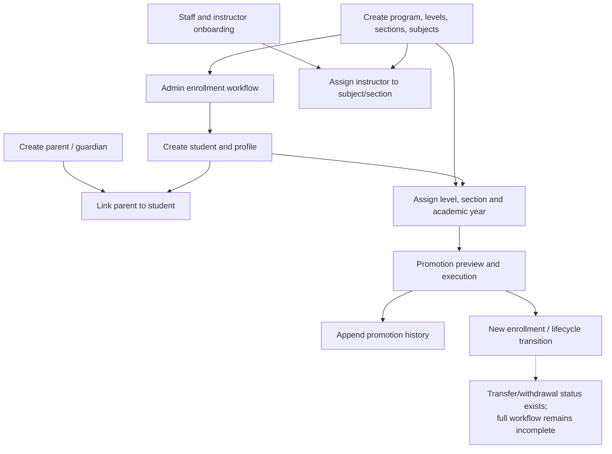

The dashboard's admissions route is an admin-side enrollment wizard, not a prospective-applicant application pipeline.

### 3.3 Timetable and attendance

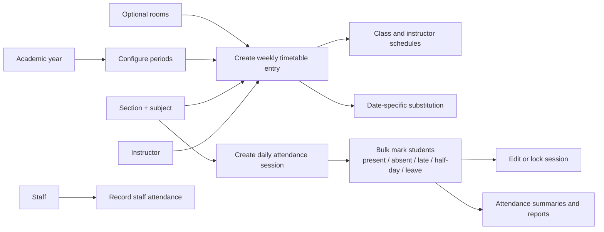

### 3.4 Examinations and results

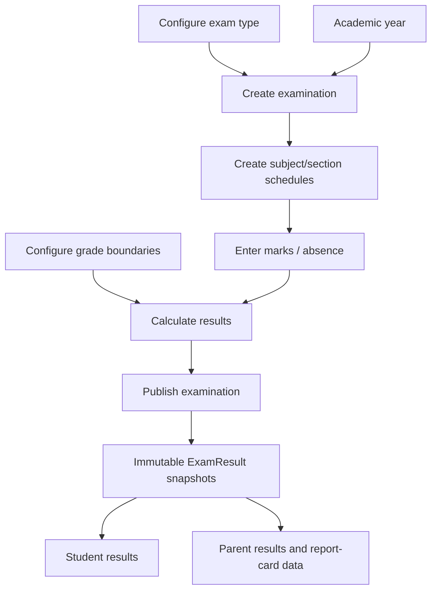

### 3.5 Fees and payment recording

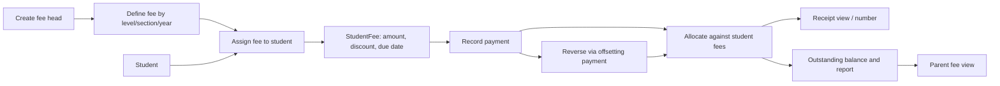

This is manual payment recording. The eSewa signup flow does not currently mean that students or parents can pay school fees online.

### 3.6 Course content and assignments

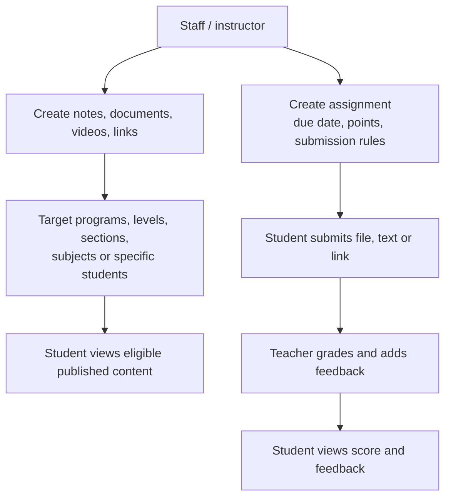

### 3.7 Announcements and notifications

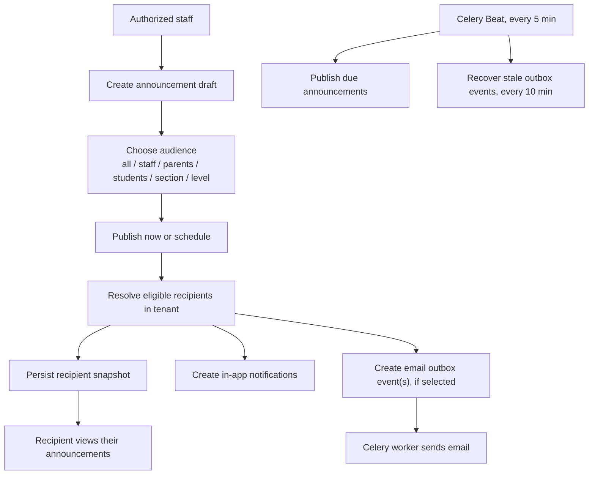

## 4. Proposed workflows — not implemented modules

Dashed arrows and headings in this section are proposals based on identified gaps; they do not describe existing application behavior.

### 4.1 Admissions applicant pipeline

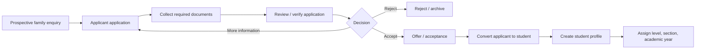

### 4.2 Staff leave and attendance reconciliation

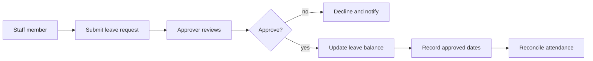

### 4.3 Fee online payment, installments and scholarships

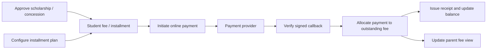

### 4.4 Student transfer, documents and certificates

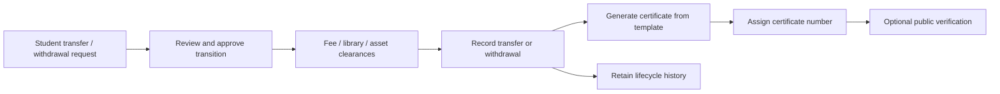

### 4.5 Library and transport

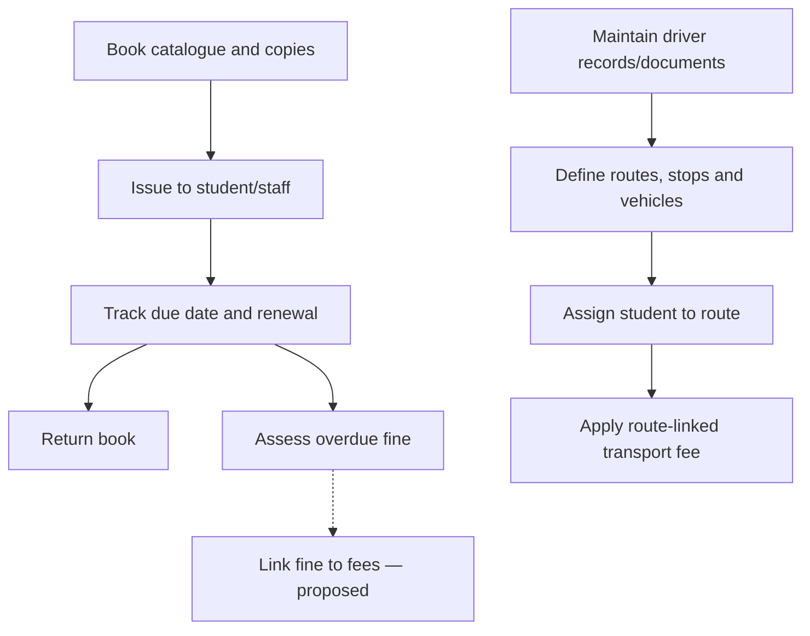

### 4.6 Health, calendar, LMS extensions and inventory

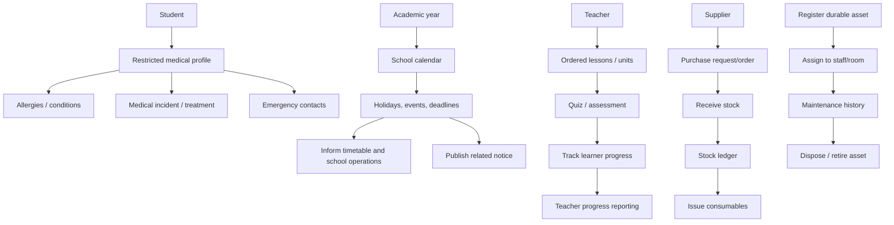

## 5. Suggested dependency roadmap

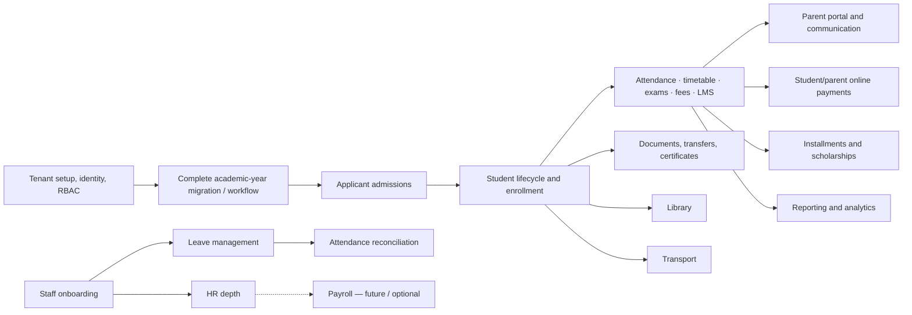

## 6. Current implementation caveats

- Announcements are implemented in the backend and tenant frontend; earlier gap-analysis entries calling them missing are stale.
- The parent portal reads child attendance, timetable, published results, and fees, with child-access checks.
- Student fee online payment is separate from the public school signup payment integration.
- The AcademicYear entity exists and nullable FK fields have been added in some models, but planning documents state that the larger FK backfill/dual-write phase remains unapproved and has unresolved decisions. Do not infer that year migration is complete from the presence of the model or fields.
- This diagram is a documentation summary. It does not establish that deployment infrastructure, external services, or every UI/API path has been runtime-tested.
