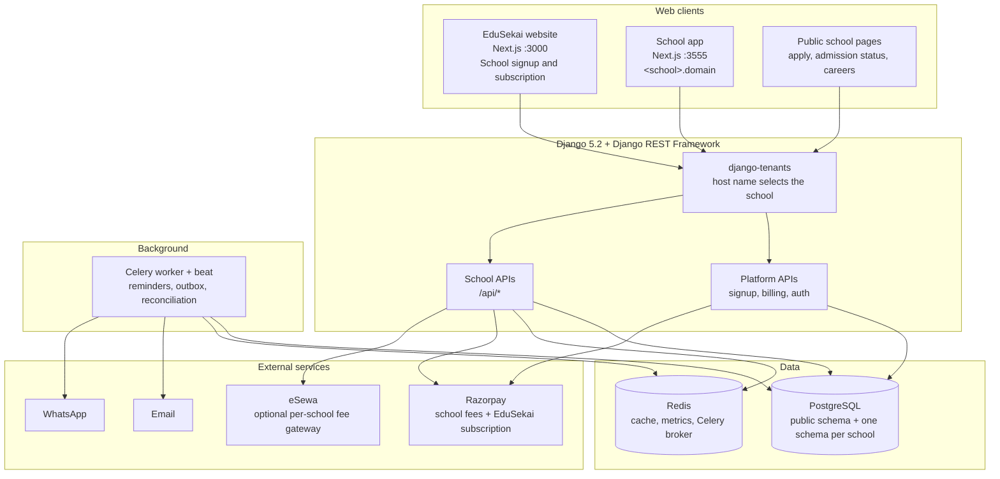
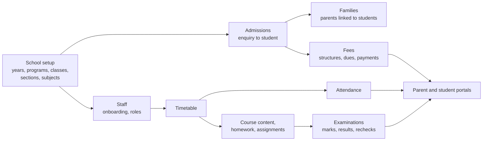
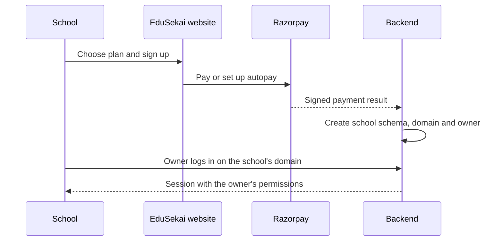
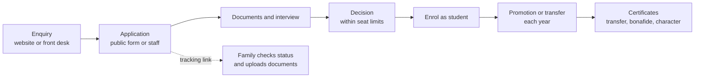
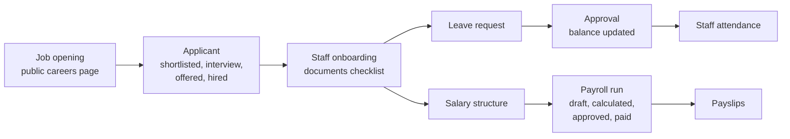
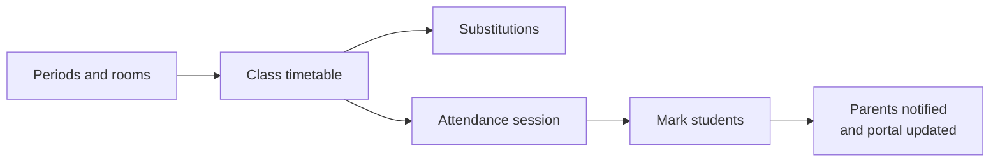
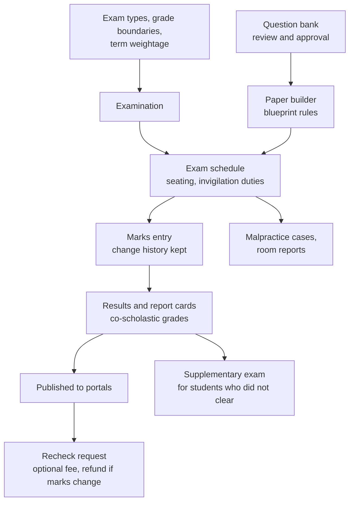
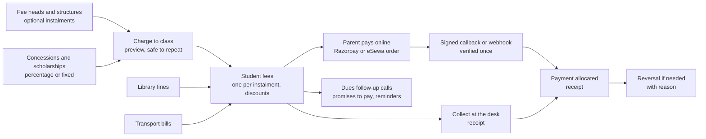
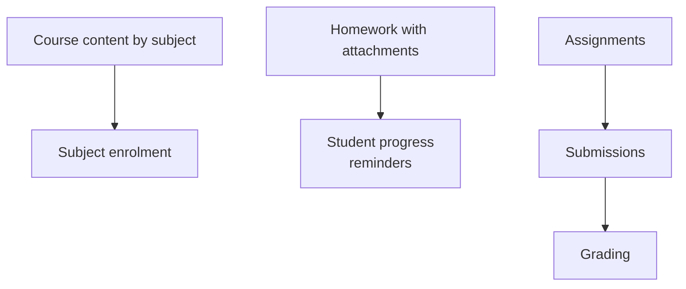
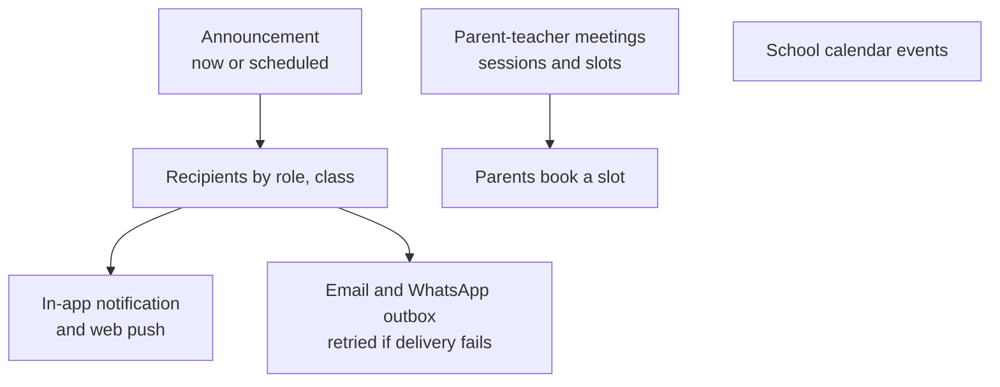

# EduSekai — System Architecture and Module Workflows

> **Scope:** Reflects the code on `main` as of 11 November 2026. Written from the repository; the workflows marked as browser-tested were also run end to end on a test copy of the system.

## 1. System architecture

**Tenant isolation:** the school's subdomain or domain selects its PostgreSQL schema. All school records live in that schema. User accounts live in the public schema and are linked from school profiles by UUID, not by cross-schema foreign keys.

**Payment gateways:** each school chooses and configures its own fee gateway (Razorpay or eSewa). Schools in India use Razorpay. EduSekai's own subscription billing to schools also uses Razorpay, including autopay mandates and GST invoices.

**Access control:** every school API checks a named permission through roles (`roles` app). The school owner role holds every permission. Platform operators (superusers) see platform-wide tools such as System Health.

**Background jobs (Celery beat):** homework reminders, fee reminders and follow-ups, admission follow-ups and missing documents, pending exam marks, scheduled announcements, notification outbox recovery, online payment and signup payment reconciliation, subscription refresh and a system heartbeat.

## 2. Core school workflow

## 3. Module workflows

### 3.1 School signup, login and access

- Staff, students and parents get logins from **Portal Access**, which can export login details still to be handed out (CSV).
- The **Subscription & Billing** page shows the plan, autopay mandate and GST invoices.

### 3.2 Admissions and student lifecycle

- Families apply online at `/apply` and choose the class themselves. They get a reference number and a private tracking link. Staff can issue a fresh tracking link from the application.
- Seat limits and required documents are set per class. Follow-up and missing-document reminders are sent automatically.
- Certificates (transfer, bonafide, character, staff experience) are numbered in sequence and can be cancelled. ID cards carry a verification token.

### 3.3 Staff, leave, payroll and recruitment

### 3.4 Timetable and attendance

### 3.5 Examinations and results

- Browser-tested: marks entry, recheck with fee and refund, supplementary exam list and CSV export.

### 3.6 Fees and online payment

- Online payments settle exactly once, even with duplicate callbacks, a late webhook or the parent's browser never returning. Pending orders are reconciled in the background.
- A structure can be split into instalments (for example 40/30/30 across three terms). Charging it to its class creates one student fee per instalment for every active student, with each student's concessions taken off; running it again only adds what is missing, such as students who joined later. The instalments are fixed once anyone has been charged.
- Library fines and transport bills each create a student fee, so they appear in the same dues and receipts.

### 3.7 Learning: course content, homework and assignments

### 3.8 Communication

### 3.9 Operations

- **Front office:** visitor log with badges, student gate passes with a picked-up-by record, postal in and out.
- **Library:** catalogue, copies, loans and returns, fines.
- **Transport:** vehicles, drivers, routes and stops, student assignment, transport bills.
- **Inventory:** stock items and locations, suppliers and purchases, assets with assignment and maintenance.
- **Expenses:** categories, payment accounts, cashbook.
- **Data import:** CSV import of students, staff and opening balances.
- **Health records:** each student's allergies, conditions, medicines and doctor, an incident log that cannot be deleted, and a per-section list of students to know about. Teachers read, a nurse or the office edits, and a parent reads their own child's.
- **Audit logs:** who changed what.
- **System Health:** API traffic, errors and background-job heartbeat. The full view is for platform operators. School owners see their own school.

## 4. Not built yet

These gaps were found in the code. They are candidates, not commitments.

- **Hostel:** no rooms, allocation or hostel fees.
- **Learning extensions:** no quizzes inside course content and no lesson ordering or progress tracking beyond homework progress.

## 5. Notes

- Academic years exist. Some models link to a year, and the rest of the year migration is still a planned piece of work.
- Every school API refuses a malformed query value with a 400 response, not a server error.
- This document describes the design. Infrastructure and deployment are covered under `deploy/`.
